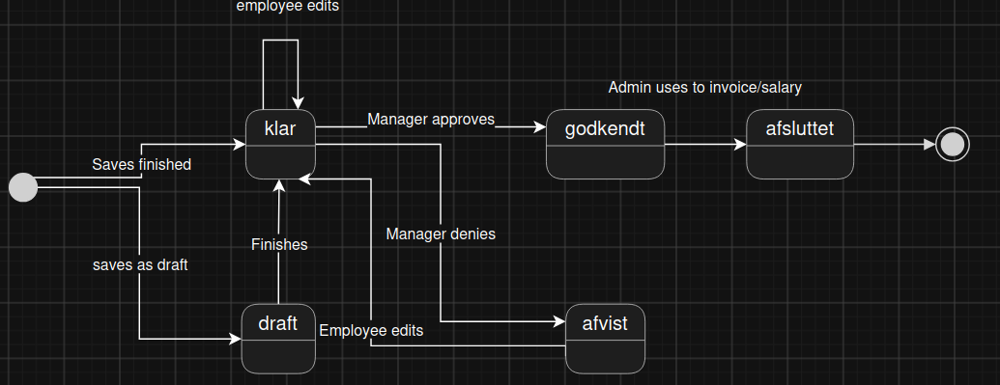

# M3: PWA with Offline Registration and Microsoft Entra ID

Status: **Draft**

## Goal

Make time registration available offline in a PWA, move authentication to Microsoft
Entra ID, and improve how work is assigned, reviewed, and finalized.

## Target Dates

- Approximate start: 4 November 2026.
- Approximate completion: 2–4 December 2026. After that, the focus shifts to
  documentation, diagrams, and reports.

## Planned Scope

### Platform and access

- Make the frontend installable as a Progressive Web App (PWA).
- Let employees save time registrations offline and synchronize them when a
  connection returns.
- Replace the current Identity Core/pilot login with Microsoft Entra ID for
  sign-in; enforce authorization for employees, managers, and administrators.
- Introduce departments in the domain model rather than relying solely on a
  direct employee-to-manager relationship.
- Add application logs to help diagnose problems.

### Time registration and approval

- Allow employees to record items used for a task alongside a time registration,
  and attach pictures or supporting files such as documentation.
- Allow employees to mark a task as finished so a manager can review and
  approve or close it. Task completion and time-entry approval are separate.
- Define a clear time-entry lifecycle:

  | Status | Meaning |
  | --- | --- |
  | Draft (`kladde`) | Saved but not yet submitted for approval. |
  | Ready for approval (`klar til godkendelse`) | Submitted for manager review. |
  | Approved (`godkendt`) | Approved by a manager. |
  | Rejected (`afvist`) | Returned for correction. |
  | Closed (`afsluttet`) | An approved entry exported by an administrator or manager for invoicing or payroll; permanently locked. |

- Keep approved time entries locked as in M2. A rejected entry can be corrected
  and resubmitted for approval; a closed entry cannot be edited even with a
  temporary editing permission.
- Keep an audit trail of time-registration changes: who made each change and when.
- Let administrators configure the period in which time entries can be edited
  before they are locked. Allow administrators to grant temporary permission to
  add entries or edit/delete unapproved entries outside that period.

The proposed status transitions are illustrated below; the exact rules still
need to be agreed before implementation.

### Work planning and oversight

- Let managers assign tasks to employees so they know what work to do.
- Let managers control which projects and tasks each employee can access.
- Let managers set expected work hours for individual tasks.
- Show managers an overview of employee workload to help distribute work and
  plan available capacity.
- Provide a time-registration overview for managers and administrators, with
  filters for project, task, employee, date, and status. Links from an order,
  task, or employee page should open the overview with relevant filters applied.

### Notifications and interface

- Notify employees when a manager assigns them a task or rejects a time entry,
  as well as when an offline registration has synchronized.
- Improve the desktop navigation (for example, a left-side menu) while keeping
  the mobile navigation usable.

## Acceptance Criteria

- Employees can install the PWA, register time while offline, and see when the
  registration has successfully synchronized.
- Users sign in with Microsoft Entra ID and can access only permitted work and
  time entries.
- Managers can assign tasks and control employees' access to projects and tasks.
- Managers can set expected task hours and view employee workload.
- Managers can review and approve or reject time entries within their permitted
  scope.
- Time entries follow the agreed lifecycle, with changes recorded in an audit
  trail; approved entries remain locked and closed entries cannot be changed.
- Administrators can configure editing periods and grant time-limited exceptions
  without allowing edits or deletion of approved or closed entries.
- Managers and administrators can filter the time-registration overview and
  reach it from related order, task, and employee pages.

## Open Decisions and Possible Follow-ups

- Agree on the exact time-entry transitions: whether saving a draft is explicit,
  whether finishing a task submits its entries, and whether every edit should
  move an unapproved entry to ready for approval.
- Define offline conflict handling and what happens if a queued registration is
  rejected by the server after reconnection.
- Decide how departments relate to managers and employee assignments, and which
  notification delivery method to use.
- Decide which temporary editing windows to offer (for example, 1, 2, 3, 5, or
  7 hours), and how they interact with the normal editing period.
- Explore management of commonly used item packages and discounts.
- Explore Nextsign digital signatures for monthly salary approvals.
- Explore employee scheduling on tasks and later customer notifications.

## Result

To be completed after the milestone.
